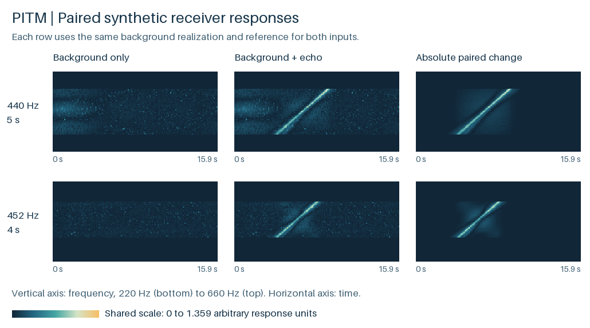

# PITM acoustic receiver demo

CPU companion to *Physics-Informed Topological Mapping for Active Sonar Detection Across Transmit Waveforms* by Boyu Zhao, Wenjie Zhou, Yuqi Zheng and Xiaokun Jia.

Inject a modeled echo into a fixed shallow-water background and inspect how the waveform-conditioned receiver response changes. For each of two transmit pulses, the demo processes a background-only observation and a second observation containing exactly the same background plus the echo. The two observations share an independent, target-free reference window.



The first two columns show the absolute magnitude of the fused feature. The last column shows the magnitude of the difference between the two **signed** features. All six panels share one amplitude scale.

## Run

From the repository directory with Python 3.11 or newer, create and activate a virtual environment, then run:

```bash
python -m pip install -r requirements.txt
python pitm_demo.py
```

The bundled example ran with Python 3.12 and NumPy 2.3.5. A successful run prints `4 cases passed`. Open `outputs/paired_response.png`, or read the numerical arrays and diagnostics:

| Output | Contents |
| --- | --- |
| `outputs/forward_maps.npz` | Signed projected, masked and fused response arrays. Each is indexed by case, frequency and time. The file includes both coordinate axes. |
| `outputs/checks.json` | Per-case passbands, branch half-spans, ADMM iteration and residual statistics, projection and kernel orthogonality checks, gating errors, and the peak paired change for each pulse. |

For the default seed, the largest absolute paired changes are about **1.1519** at 540 Hz and 8.5 s and **1.0536** at 405 Hz and 5.1 s, respectively. These are feature amplitudes in arbitrary units. The clean injection and target flags are used to check the pairs after both forward passes.

## Rebuild the data

```bash
python pitm_demo.py --generate --seed 20261104 --data rerun/synthetic_tf.npz --output rerun/outputs
```

This generates a second copy of the input and writes the new outputs under `rerun/`. With the same seed and tested numerical environment the regenerated input and output arrays agree with the default run element for element. Change the seed to use a different background realization.

## What the receiver computes

1. **Synthetic input.** The grid spans 220–660 Hz in 5 Hz bins and 0–15.9 s in 0.1 s frames. The echo sums three swept ridges with an explicit leading-order modal-delay approximation using modes 1, 8 and 16, a 110 m guide and an 18 km effective path. Two smooth background components are combined with a heavy-tailed amplitude perturbation.
2. **Background projection.** ADMM separates a low-rank reference from a sparse component. The example estimates its two leading left singular vectors on the 60-frame reference, then applies the orthogonal-complement projector to the observation.
3. **Transmit mask.** For a chirp rate of +50 Hz/s the 440 Hz, 5 s pulse admits 315–565 Hz. The 452 Hz, 4 s pulse admits 352–552 Hz. The mask tests the centers of discrete frequency bins against these continuous bounds.
4. **Fractional sampling.** Three branches use radii 1, 3 and 5. Each evaluates a smooth kernel and an orthogonalized fast kernel with zero-extended bilinear interpolation. Soft thresholding acts on the fast response.
5. **Fusion.** A per-cell softmax of absolute branch responses supplies weights for their signed sum. Each run checks projection residuals, kernel inner products, normalization of fusion weights and exact rejection of out-of-band cells.

The synthetic grid, fixed rank, analytic kernels and fusion weights follow the manuscript's **executable supplement**. The maps expose individual forward operators and their units. The trained detection head, benchmark SNR sweeps and Dongjiang Lake measurements belong to the separate experimental study. The feature amplitudes here do not estimate its detection probability, false-alarm rate or bearing error.

## Inspect a paired response in Python

```python
import numpy as np

with np.load("data/synthetic_tf.npz") as x, np.load("outputs/forward_maps.npz") as y:
    # Cases 0/1 are the 440 Hz pair. Cases 2/3 are the 452 Hz pair.
    np.testing.assert_allclose(x["raw"][1] - x["raw"][0], x["clean_echo"][1], atol=1e-12)
    difference = y["response"][1] - y["response"][0]
    fi, ti = np.unravel_index(np.abs(difference).argmax(), difference.shape)
    print(y["frequency_hz"][fi], y["time_s"][ti], difference[fi, ti])
```
